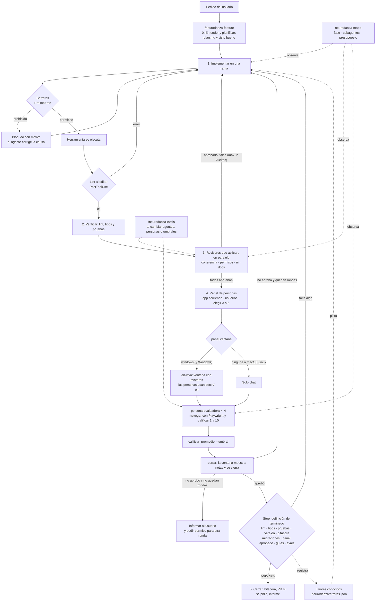

# 1. Cómo funciona

neurodanza es **un solo plugin** de Claude Code (está en la raíz del repo; el marketplace es `.claude-plugin/marketplace.json`). Trae:

| Pieza | Archivo | Qué es |
|---|---|---|
| Configuración | `lib/config.mjs` | Carga `neurodanza.config.json`, aplica valores por defecto y valida. |
| Hooks | `hooks/hooks.json` | Registra los errores conocidos (`SessionStart`), las barreras (`PreToolUse`), el lint al editar (`PostToolUse`) y la definición de terminado (`Stop`). |
| Barreras | `hooks/guardrails.mjs` | Decide si una herramienta se permite. |
| Retroalimentación | `hooks/feedback.mjs` | Errores conocidos al iniciar, lint al editar y revisión completa al terminar (en paralelo y con caché). |
| Errores conocidos | `lib/errores.mjs` | Catálogo del proyecto: firma, contador y solución de cada problema que marcan los hooks. |
| Director | `lib/director.mjs` y `agents/implementador.md` | Modo director: worktrees por tarea, contratos e integración del diff. |
| Constructos | `lib/constructos.mjs` | Lecciones por agente: reflexión al cerrar, a prueba, aprobadas solo si mejoran. |
| Ciclo | `lib/ciclo.mjs` | Qué revisores aplican al diff y el presupuesto de pasos. |
| Mapa en vivo | `mapa/` (plugin `neurodanza-mapa`) | Panel al lado del chat con la fase, cada subagente y el plan; avisa a los subagentes por presupuesto y bucles. |
| Agentes | `agents/*.md` | 4 revisores y la `persona-evaluadora`. |
| Skills | `skills/*/SKILL.md` | `/neurodanza-init`, `/neurodanza-feature`, `/neurodanza-evals`. |
| Panel | `panel/panel.mjs` y `panel/*.ps1`, `panel/*.vbs` | Elegir personas, crear usuarios, navegar, calificar y las ventanas de Windows. |
| Evals | `evals/evals.mjs` | Arma las instrucciones de evaluación y califica. |
| ESLint | `eslint/no-junk-comments.mjs` | Regla contra comentarios basura y firmas de IA. |

## Regla de oro: sin configuración, nada

Cada hook busca `neurodanza.config.json` subiendo desde la carpeta de trabajo (hasta 8 niveles). Si no lo encuentra, sale sin hacer nada. Si el archivo existe pero es inválido, escribe el error y **no bloquea** (sale con código 0), para que una configuración rota no te deje sin trabajar.

## El ciclo completo

## Qué es automático y qué no

- **Automático (hooks):** barreras, lint al editar y la revisión al terminar. Corren solos en cada sesión de Claude Code dentro de un proyecto configurado.
- **Guiado (skills):** revisores, panel y evals. Los orquesta Claude siguiendo `/neurodanza-feature` y `/neurodanza-evals`. El hook `Stop` sí exige el resultado: no deja terminar un cambio de pantallas sin una evaluación del panel aprobada para la versión actual (ver [05-retroalimentacion.md](05-retroalimentacion.md)).

## Lo que nunca hace

- No hace commit ni push si no se lo pides, y nunca agrega coautoría ni firmas de IA.
- No arranca servicios que solo tú puedes abrir (Docker Desktop, una VPN…): te los pide.
- Las personas no modifican código ni documentación; dejan sus capturas e informes fuera de los repos.
