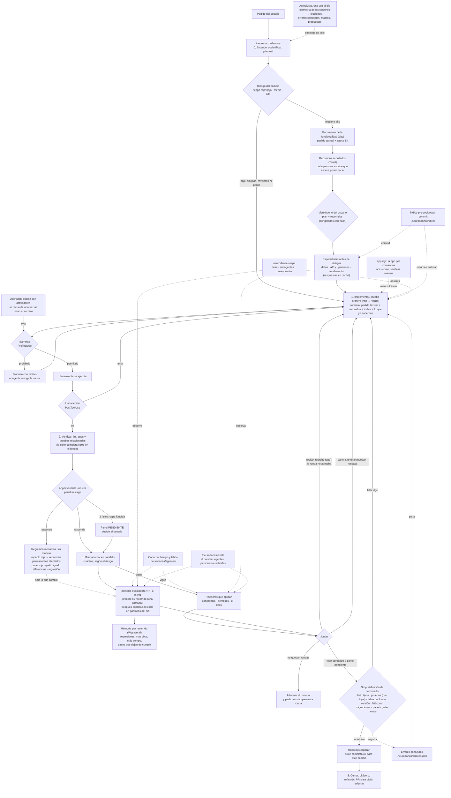

# 1. Cómo funciona

neurodanza es **un solo plugin** de Claude Code (está en la raíz del repo; el marketplace es `.claude-plugin/marketplace.json`). Trae:

| Pieza | Archivo | Qué es |
|---|---|---|
| Configuración | `lib/config.mjs` | Carga `neurodanza.config.json`, aplica valores por defecto y valida. |
| Hooks | `hooks/hooks.json` | Registra los errores conocidos y la autoconfiguración (`SessionStart`), las barreras y el tiempo por subagente (`PreToolUse`), el lint al editar (`PostToolUse`), la definición de terminado (`Stop`), el fin de cada subagente (`SubagentStop`) y el cierre de la ronda del panel (`SessionEnd`). |
| Barreras | `hooks/guardrails.mjs` | Decide si una herramienta se permite. |
| Retroalimentación | `hooks/feedback.mjs` | Errores conocidos al iniciar, lint al editar y revisión completa al terminar (en paralelo y con caché). |
| Errores conocidos | `lib/errores.mjs` | Catálogo del proyecto: firma, contador y solución de cada problema que marcan los hooks. |
| Director | `lib/director.mjs` y `agents/implementador.md` | Modo director: worktrees por tarea, contratos e integración del diff. |
| Constructos | `lib/constructos.mjs` | Lecciones por agente: reflexión al cerrar, a prueba, aprobadas solo si mejoran. |
| Velocidad | `lib/procesos.mjs`, `lib/firma.mjs`, `lib/fondo.mjs`, `lib/agentes.mjs`, `lib/fusible.mjs` | Comandos con tope que matan su árbol, firma del cambio, suite completa en segundo plano, tiempo y latido por subagente, fusible por capa externa. Ver [15-velocidad.md](15-velocidad.md). |
| No perder trabajo | `lib/pilas.mjs`, `hooks/pilas.mjs`, `director.mjs decidir`/`rebobinar` | Pila de cada subagente, re-enfundar guiado y rebobinar con memoria. Ver [16-no-perder-trabajo.md](16-no-perder-trabajo.md). |
| Seguridad | `lib/figuras.mjs`, `lib/fantasmas.mjs`, `agents/fantasma.md` | Figuras y manos, segunda llave (`ask`), cuarentena y fantasmas en modo propuesta. Ver [17-seguridad.md](17-seguridad.md). |
| Panel con recorridos | `lib/recorridos.mjs`, `panel.mjs navegar --recorrido` / `comparar` | Recorridos acordados antes de implementar, memoria por versión y regresiones de experiencia. Ver [18-panel-con-recorridos.md](18-panel-con-recorridos.md). |
| Menos exploración | `lib/indice.mjs`, `lib/hotel.mjs`, `lib/operador.mjs`, `agents/especialista-*.md` | Índice pre-cocido por commit, especialistas antes de delegar y lecciones que se recuerdan al tocar sus archivos. Ver [19-menos-exploracion.md](19-menos-exploracion.md). |
| Proporcionalidad y ODD | `lib/riesgo.mjs`, `lib/cambios.mjs`, `lib/funcionalidad.mjs`, `lib/pruebas.mjs` | Riesgo del cambio (bajo, medio, alto) y qué corre en cada uno; documento de la funcionalidad con el pedido textual; prueba en rojo antes de implementar. Ver [20-odd-en-neurodanza.md](20-odd-en-neurodanza.md). |
| Autoajuste | `lib/telemetria.mjs`, `lib/autoajuste.mjs` | Telemetría de las sesiones (de los transcripts, sin hooks nuevos) y una pasada al día que aprende lecciones, errores conocidos y macros con su freno, y propone presupuestos y arreglos que después evalúa. Ver [22-autoajuste.md](22-autoajuste.md). |
| Regresión mecánica | `lib/impacto.mjs`, `lib/regresion.mjs`, `panel.mjs repetir` | Mapa de impacto (imports y layouts → pantallas → recorridos permanentes) y repetición sin modelo con la firma de cada pantalla; solo lo que cambió va a su persona. Ver [23-regresion-mecanica.md](23-regresion-mecanica.md). |
| CLI de la app | `lib/app.mjs`, `lib/comentarios.mjs` | La app por comandos (sesiones en caché, peticiones, verificar), macros que nacen del uso y la barrera de comentarios. Ver [21-cli-de-la-app.md](21-cli-de-la-app.md). |
| Ciclo | `lib/ciclo.mjs` | Qué revisores aplican al diff, según su riesgo, y el presupuesto de pasos. |
| Mapa en vivo | `mapa/` (plugin `neurodanza-mapa`) | Panel al lado del chat con la fase, cada subagente y el plan; avisa a los subagentes por presupuesto y bucles. |
| Agentes | `agents/*.md` | 4 revisores y la `persona-evaluadora`. |
| Skills | `skills/*/SKILL.md` | `/neurodanza-init`, `/neurodanza-feature`, `/neurodanza-evals`. |
| Panel | `panel/panel.mjs` y `panel/*.ps1`, `panel/*.vbs` | Elegir personas, crear usuarios, navegar, calificar y las ventanas de Windows. |
| Evals | `evals/evals.mjs` | Arma las instrucciones de evaluación y califica. |
| ESLint | `eslint/no-junk-comments.mjs` | Regla contra comentarios basura y firmas de IA (y modo estricto, con el criterio de la barrera). |

## Regla de oro: sin configuración, nada

Cada hook busca `neurodanza.config.json` subiendo desde la carpeta de trabajo (hasta 8 niveles). Si no lo encuentra, sale sin hacer nada. Si el archivo existe pero es inválido, escribe el error y **no bloquea** (sale con código 0), para que una configuración rota no te deje sin trabajar.

## El ciclo completo

## Qué es automático y qué no

- **Automático (hooks):** barreras, lint al editar y la revisión al terminar. Corren solos en cada sesión de Claude Code dentro de un proyecto configurado.
- **Guiado (skills):** revisores, panel y evals. Los orquesta Claude siguiendo `/neurodanza-feature` y `/neurodanza-evals`. El hook `Stop` sí exige el resultado: no deja terminar un cambio de pantallas sin una evaluación del panel aprobada para la versión actual (ver [05-retroalimentacion.md](05-retroalimentacion.md)).

## Lo que nunca hace

- No hace commit ni push si no se lo pides, y nunca agrega coautoría ni firmas de IA.
- No arranca servicios que solo tú puedes abrir (Docker Desktop, una VPN…): te los pide.
- Las personas no modifican código ni documentación; dejan sus capturas e informes fuera de los repos.
