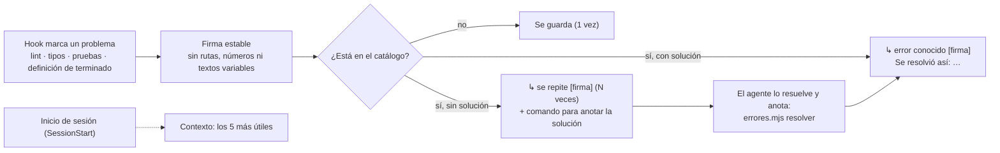

# 12. Errores conocidos

Un error que ya se resolvió una vez no debería investigarse de cero la segunda. neurodanza guarda cada problema que marcan sus hooks en un catálogo del proyecto (`errores.archivo`, por defecto `.neurodanza/errores.json`), y cuando el error vuelve, muestra cómo se resolvió.

## Cómo funciona



1. **Firma.** El texto del error se normaliza (las rutas pasan a `<ruta>`, los números a `<n>`, los hashes a `<hash>` y los textos entre comillas a `…`) y se resume en 10 caracteres. El mismo error de tipos en otro archivo u otra línea tiene la misma firma.
2. **Contador.** Cuenta **una vez por sesión**: el mismo error que bloquea 3 veces seguidas en una sesión cuenta como 1.
3. **Pista.** Desde la segunda vez, el hook agrega al mensaje:
   ```
   ✖ backend · tipos:
   src/pedidos/pedidos.service.ts(42,7): error TS2322: …
     ↳ error conocido [72d52f03ca] (3 veces). Se resolvió así: Convertir con Number() en el borde del DTO
   ```
4. **Al iniciar la sesión** (hook `SessionStart`), los errores más útiles (con solución primero, luego los más repetidos; `errores.alIniciar`, 5 por defecto) entran como contexto, para que el agente los tenga en cuenta al planificar.

## Comandos

Desde cualquier carpeta del proyecto:

```
node <plugin>/lib/errores.mjs listar              # los repetidos o con solución
node <plugin>/lib/errores.mjs listar --todos      # todos
node <plugin>/lib/errores.mjs resolver --firma 72d52f03ca --solucion "Convertir con Number() en el borde del DTO"
node <plugin>/lib/errores.mjs buscar --texto "<mensaje de error>"
```

`/neurodanza-feature` le pide al agente que anote la solución apenas resuelve un error que se repite, y que lo revise al cerrar.

## Buenas soluciones

Una línea que diga **qué hacer**, no qué pasó: «Correr `pnpm prisma generate` antes de `tsc`», «Usar el logger del proyecto en vez de `console`», «El mock de `AuthService` va en `test/setup.ts`». Si la solución cambia, vuelve a correr `resolver` con la nueva.

## Dónde vive

`.neurodanza/errores.json` **se versiona**: así lo aprovecha todo el equipo y cada máquina. `/neurodanza-init` agrega a `.gitignore` `.neurodanza/*` y `!.neurodanza/errores.json`, porque el plan y el estado del ciclo son locales.

Los problemas del plugin mismo (no del proyecto) están en [10-problemas-comunes.md](10-problemas-comunes.md).
