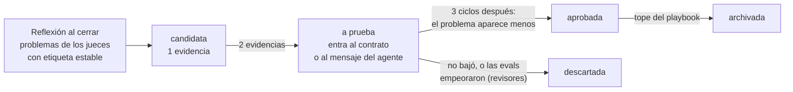

# 14. Constructos: agentes que aprenden, con freno

Sin memoria, cada ciclo empieza de cero: si un revisor encontró un botón sin `aria-label` en el código del implementador de frontend, el próximo implementador vuelve a olvidarlo. Un **constructo** es un agente con nombre (`implementador-frontend`, `revisor-ui`…) que **acumula experiencia en el proyecto**: lecciones que nacen de lo que encontraron los jueces y que solo se quedan si demuestran que mejoran algo.

No es entrenamiento del modelo: es experiencia curada, medida y versionada en el repo.

## El ciclo de una lección



1. **Reflexión.** Al cerrar cada ciclo, `/neurodanza-feature` escribe un JSON con los problemas que encontraron los revisores, las personas y los errores repetidos, cada uno anotado al constructo que lo **causó**, con una **etiqueta** estable (`area:tema`, p. ej. `ui:aria-label-icono`) y una **lección** accionable.
2. **Candidata.** La primera vez que aparece un problema, su lección queda como candidata (todavía no cambia nada).
3. **A prueba.** Con `constructos.minEvidencias` evidencias (2), pasa a prueba: desde ahí viaja en el **contrato** del implementador (`director.mjs preparar --constructo …`) o en el **mensaje** del revisor (`constructos.mjs playbook`).
4. **Juicio.** Tras `constructos.ciclosPrueba` ciclos (3) en los que participó ese constructo, se compara cuántas veces por ciclo aparece el problema **antes** (desde la primera evidencia) y **después**:
   - si bajó → **aprobada**;
   - si no → **descartada** y sale del playbook.
   - **Revisores y personas**, además, necesitan unas evals posteriores (`/neurodanza-evals`, que ya incluyen sus lecciones en las instrucciones) **aprobadas, sin menos detección ni más falsos positivos** que las anteriores. Sin evals nuevas, la lección espera.
5. **Tope.** Si un constructo pasa de `constructos.maxLecciones` (30) lecciones activas, se archivan las aprobadas con menos evidencias.

Cada cambio de estado queda en el `CHANGELOG.md` del constructo, con el motivo (`0.67 → 0.00 por ciclo`).

## Dónde vive: lo crudo, local; lo aprendido, en git

```
.neurodanza/constructos/                     ← LOCAL (cambia en cada ciclo)
  constructos.json                           ciclos, evidencias, candidatas, a prueba, descartadas
  implementador-frontend/playbook.md         informe legible de todo
  implementador-frontend/CHANGELOG.md        cada cambio de estado con su motivo

<repo>/.neurodanza/aprendido/                ← EN GIT (cambia solo al aprobarse algo)
  implementador-frontend.md                  - Todo botón de solo icono lleva aria-label. `ui:aria-label-icono`
  revisor-ui.md
```

- **Lo crudo** (medición) es local: cambia en cada ciclo y en git solo ensuciaría los commits y chocaría entre ramas.
- **Lo aprendido** (las lecciones aprobadas) se versiona. Cuando una lección se aprueba, aparece en tu PR como una línea nueva que revisas como cualquier cambio: es un **freno humano** sobre el freno automático. Si una lección se descarta o se archiva, su línea se quita.
- **Lo compartido manda:** los agentes usan las aprobadas que están en `aprendido/`. Si en un PR alguien borra una línea, esa lección deja de usarse aunque en tu máquina siga aprobada. Las que están a prueba salen de lo local.
- **Dónde va lo aprendido** (`constructos.compartido: "auto"`): en la raíz si es un repo; si no (varios repos sueltos, como `backend/`, `frontend/`, `docs/`), en el repo de documentación (`retroalimentacion.docs`); si no hay, queda local. Da igual si abres Claude en la raíz o dentro de un componente: el proyecto es el mismo.

## La reflexión

```json
{ "ciclo": "exportar-pedidos-v2.1.0", "version": "2.1.0",
  "agentes": [{ "constructo": "implementador-frontend", "pasos": 34, "terminado": true }, { "constructo": "revisor-ui" }],
  "problemas": [{ "constructo": "implementador-frontend", "etiqueta": "ui:aria-label-icono", "fuente": "revisor-ui",
                  "detalle": "botón de solo icono sin aria-label en pedidos/filtros.tsx",
                  "leccion": "Todo botón de solo icono lleva aria-label en el idioma del producto." }] }
```

- `agentes`: quiénes trabajaron (un ciclo limpio también cuenta para medir).
- `problemas`: un problema por hallazgo alto o medio, queja de persona que bajó la nota o error repetido. Si un revisor dejó pasar algo que encontró otro juez, el problema también va a su nombre.
- La etiqueta debe ser **la misma** para el mismo problema en cada ciclo: es lo que permite medir.

## Comandos

```
node <plugin>/lib/constructos.mjs reflexion --archivo <json>      registra el ciclo y juzga lo que esté a prueba
node <plugin>/lib/constructos.mjs estado [--constructo <n>]       lecciones por estado
node <plugin>/lib/constructos.mjs playbook --constructo <n>       texto para el mensaje o el contrato
node <plugin>/lib/constructos.mjs evaluar                         juzga de nuevo (p. ej. tras correr las evals)
node <plugin>/lib/constructos.mjs probar|descartar|archivar --constructo <n> --etiqueta <e> [--motivo "…"]
```

`probar`, `descartar` y `archivar` son para decidir a mano (por ejemplo, descartar una lección que no tiene sentido aunque tenga evidencias). Con `"constructos": { "automatico": false }` nada pasa a prueba solo: lo decides tú con `probar`.

## Lo que esto no hace

- **No reescribe las reglas del proyecto** (`reglas.*`) ni los agentes del plugin: las lecciones viajan aparte, en el mensaje, y se pueden descartar.
- **No aprueba sin medir:** una lección a prueba que no tiene con qué compararse sigue a prueba.
- Una métrica por etiqueta es simple a propósito: con pocos ciclos el ruido pesa, por eso hay un mínimo de evidencias y de ciclos a prueba. Si el proyecto tiene pocos ciclos, sube `ciclosPrueba`.
